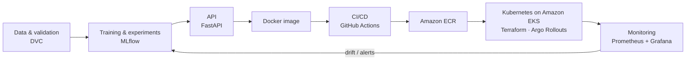

<h1 align="center">Hi, I'm Ajana King-David Ayomide 👋</h1>

  <b>Machine Learning Engineer · MLOps · Applied AI</b> 
  I build ML models and take them all the way to production: training, tracking, APIs, containers, CI/CD, Kubernetes and monitoring.

  
  
  
  

---

## 👨‍💻 About me

- 🎓 Mechatronics Engineering graduate, pursuing a Master's in Embedded AI
- 🔭 Focus: supervised learning, MLOps and applied AI
- 🚀 Working on: taking ML projects from notebook to production on AWS EKS
- 🤝 Looking to collaborate on Machine Learning projects
- 📫 Reach me at **ajanakingdavid@outlook.com**

---

## 🔁 The MLOps lifecycle I work with

---

## 🛠️ Tech stack

**ML & data** 

**Serving & apps** 

**MLOps & DevOps** 

**Cloud** 

---

## 📂 Featured projects

- **Multilingual fake news detection system**: applied ML, supervised classification
- **Accident detection**: computer vision with YOLOv8
- **Heart disease prediction pipeline**: ZenML and MLflow
- **Nigerian PMS fuel price forecasting**: hybrid ARIMA, NARNN and LSTM model

More on my portfolio: **[ajanakingdavid.carrd.co](https://ajanakingdavid.carrd.co/)**

---

## 📊 GitHub stats

  
  

  

